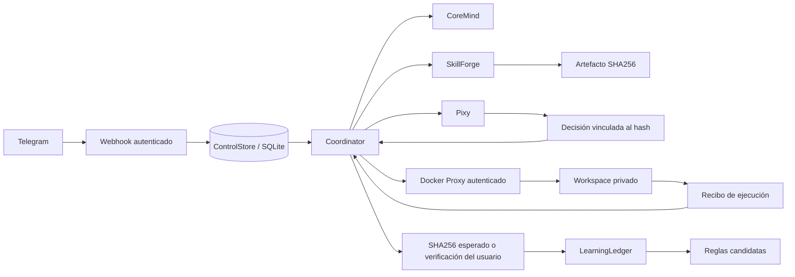

> Referencia de la revisión anterior. Para la migración corporal actual, usar [ARCHITECTURE_MIGRATION.md](ARCHITECTURE_MIGRATION.md).

# Arquitectura de Khai

## Flujo y fronteras

El Core es el único propietario del estado de objetivos. Un bloqueo de proceso impide dos coordinadores sobre el mismo directorio. El proxy tiene su propia base y un bloqueo independiente; sus operaciones Docker no se delegan al modelo.

Las llamadas HTTP del webhook no ejecutan modelos. Los objetivos se persisten antes de responder y el coordinador los avanza en segundo plano. No se utiliza una cola externa: SQLite conserva las fases y un único coordinador las procesa.

## Identidades y almacenamiento

| Identidad | Significado |
| --- | --- |
| `telegram:<update_id>` | Clave de deduplicación de la entrada o comando. |
| `task_<uuid>` | Objetivo raíz, conservado durante reintentos y cambios de hipótesis. |
| `run_<uuid>` | Intento de ejecución; se reutiliza al repetir una petición de envío incierta. |
| SHA256 | Identidad del código revisado y autorizado. |
| Token de aprobación | Identifica una decisión pendiente, con hash y vencimiento. |

`data/openclaw.db` contiene memoria, tablas históricas y las nuevas tablas `control_tasks`, `control_events`, `control_feedback`, `control_commands`, `rule_uses` y `rule_proposals`. `KHAI_DB_PATH` permite fijar una ruta absoluta común.

`data/proxy.sqlite3` guarda el payload, su fingerprint y el recibo de cada ejecución. El código vive en `data/artifacts/<sha>.py`; los inputs del worker, en `data/execution_inputs/<run>.json`; los outputs y checkpoints, en `data/workspaces/<task>/<sha>/`.

Los modelos de tareas se guardan como documentos JSON en SQLite. Las transiciones y los comandos de aprobación/verificación usan transacciones. El estado se consulta nuevamente antes de avanzar una fase; una tarea cancelada no vuelve a quedar lista.

## Estados del objetivo

| Estado | Interpretación y siguiente paso |
| --- | --- |
| `ROUTING` | Interpretar la entrada y construir su manifiesto. |
| `GENERATING` | Generar o reutilizar código verificado para la misma solicitud. |
| `REVIEWING` | Revisar AST y congruencia semántica. |
| `WAITING_APPROVAL` | Esperar un token humano asociado al hash y al plazo. |
| `READY` | Autorización válida; preparar el siguiente intento. |
| `SUBMITTED` | Intento persistido; enviar o repetir el mismo envío idempotente. |
| `RUNNING` | Consultar su recibo; no lanzar un segundo intento. |
| `UNVERIFIED` | Proceso terminado o servicio iniciado sin criterio verificado. |
| `VERIFYING` | Registrar una observación verificada, una sola vez por ejecución. |
| `DIAGNOSING` | Elegir una hipótesis alternativa bajo el presupuesto original. |
| `CANCELLING` | Cancelación solicitada; falta confirmar el resultado del proxy. |
| `COMPLETED` | Interacción terminada o resultado de habilidad verificado. |
| `FAILED` | Fallo terminal sin hipótesis alternativas disponibles. |
| `EXHAUSTED` | Límite de intentos, plazo o aprobación vencida. |
| `CANCELLED` | Cancelación confirmada o denegación antes de ejecutar. |
| `UNKNOWN` | No hay evidencia suficiente para repetir con seguridad. |

Una conversación ordinaria también termina en `COMPLETED`, pero no posee un recibo verificado ni alimenta las métricas de habilidades.

## Protocolo Core → Proxy

Todos los endpoints del proxy requieren `Authorization: Bearer <PROXY_TOKEN>`. El token no se entrega al worker.

- `POST /executions`: recibe `execution_id`, `task_id`, `artifact_hash`, `mode`, `dependencies`, `request`, `network`, `grants` y `deadline`.
- `GET /executions/{execution_id}`: consulta el recibo persistido.
- `POST /executions/{execution_id}/cancel`: solicita detener la ejecución. Puede crear una marca de cancelación antes de recibir el envío original.
- `GET /docker-ps`: devuelve ejecuciones conocidas, no control arbitrario del daemon.
- `POST /docker-logs`: consulta recibos de `agent_logs_run_<uuid>`.

El mismo ID con el mismo payload recupera su recibo; otro payload con ese ID se rechaza. Los estados del proxy son `queued`, `starting`, `running`, `started`, `finished`, `failed`, `approval_required`, `timeout`, `cancelled` y `unknown`.

`finished` incluye `returncode`, `stdout`, `stderr` y, cuando corresponde, evidencia del cierre del proceso y OOM. `approval_required` transporta `action` y `details` con salida `75`; no se transforma en una corrección automática del código.

## Aislamiento y permisos

Cada worker monta solamente su código de solo lectura, su input de solo lectura, el runner de solo lectura y un workspace de escritura. Usa raíz de solo lectura, eliminación de capabilities, `no-new-privileges`, límites de procesos, CPU, memoria y logs. La red está desactivada por defecto. Activarla requiere manifiesto Network y aprobación humana. Instalar dependencias también requiere aprobación; la construcción necesita red para descargar paquetes, aunque la habilidad permanezca offline.

El AST es una comprobación previa, no una prueba general de seguridad de Python. La revisión LLM tampoco reemplaza el aislamiento. Las aprobaciones no conceden nuevas facultades al sistema operativo: autorizan el artefacto y, para BaseSkill, operaciones declaradas dentro del mismo perímetro.

GOD conserva `run_step` y `require_approval` mediante un adaptador local del worker. Sus checkpoints están en el workspace, nunca en la base del Core. Reanudar tras aprobación inicia otra ejecución del mismo artefacto; los checkpoints evitan pasos ya registrados, pero no hacen transaccional una operación externa.

## Recuperación

El Core retoma las fases persistidas. Un envío sin respuesta se repite con el mismo ID. El proxy utiliza contenedores con nombre e identidades verificables y conserva el recibo antes de retirarlos.

Si el contenedor existe se reconcilia; si falta después de un lanzamiento incierto se declara `unknown`. Una caída del daemon conserva el estado activo para consultar nuevamente. Los fallos con posibles efectos externos se detienen en `UNKNOWN`, sin autorrepetición.

Las tareas del formato anterior se conservan y se presentan como `UNKNOWN`; no se reanudan a ciegas.

## Aprendizaje

La identidad conversacional de Khai se carga desde `data/memory/agent.md` y se
combina con las preferencias persistidas por `MemoryEngine`. Khai puede adaptar
su trato a preferencias explícitas y correcciones del usuario, pero no debe
inferir ni conservar datos sensibles sin confirmación. La personalidad no
concede permisos adicionales ni sustituye la máquina de estados.

Pixy comparte el `LLMManager` para sus revisiones, pero no es un agente con
autonomía propia: su tono puede ser juguetón y sus observaciones pueden tener
humor, mientras sus acciones permanecen limitadas por el coordinador, la
constitución y el proxy autenticado.

Los éxitos de habilidades proceden de un archivo cuyo hash esperaba el usuario o de una verificación explícita del usuario sobre un `execution_id`. Un cierre de proceso con error puede registrarse como fallo cuando existe un recibo que lo acredita. Un lanzamiento, una frase de éxito o una reflexión del modelo no generan un éxito aprendido.

`control_feedback` deduplica observaciones. Las métricas registran hipótesis, contexto y reglas utilizadas. El campo histórico `confidence` representa una proporción empírica tras recibir observaciones; no es una probabilidad causal calibrada.

Una hipótesis necesita éxitos en al menos tres objetivos diferentes y proporción de éxito de al menos 0,8 para proponer una regla `candidate`. La activación se solicita con `/rule approve`; la sustitución usa un ID `supersedes` explícito. `/rule rollback` desactiva la regla y restaura la anterior si corresponde. Las reglas utilizadas con al menos tres observaciones y proporción de éxito menor o igual a 0,3 se retiran.

Las reglas históricas sin procedencia en `rule_proposals` se preservan, pero no se inyectan como reglas verificadas en SkillForge. La detección semántica automática de contradicciones y las comparaciones controladas contra una estrategia de referencia siguen pendientes.

## Referencias de diseño

OpenClaw aporta referencias para serialización de sesiones, idempotencia, políticas de ejecución y procedencia. Hermes aporta referencias para separar memoria de hechos, historial y procedimientos, y para revisar cambios de conocimiento. Khai implementa sus propios contratos; no incorpora automáticamente las garantías de esos proyectos.

- [OpenClaw: ciclo de ejecución](https://docs.openclaw.ai/concepts/agent-loop)
- [OpenClaw: aprobaciones](https://docs.openclaw.ai/tools/exec-approvals)
- [OpenClaw: consolidación de memoria](https://docs.openclaw.ai/concepts/dreaming)
- [Hermes: skills](https://hermes-agent.nousresearch.com/docs/user-guide/features/skills)
- [Hermes: memoria](https://hermes-agent.nousresearch.com/docs/user-guide/features/memory)
