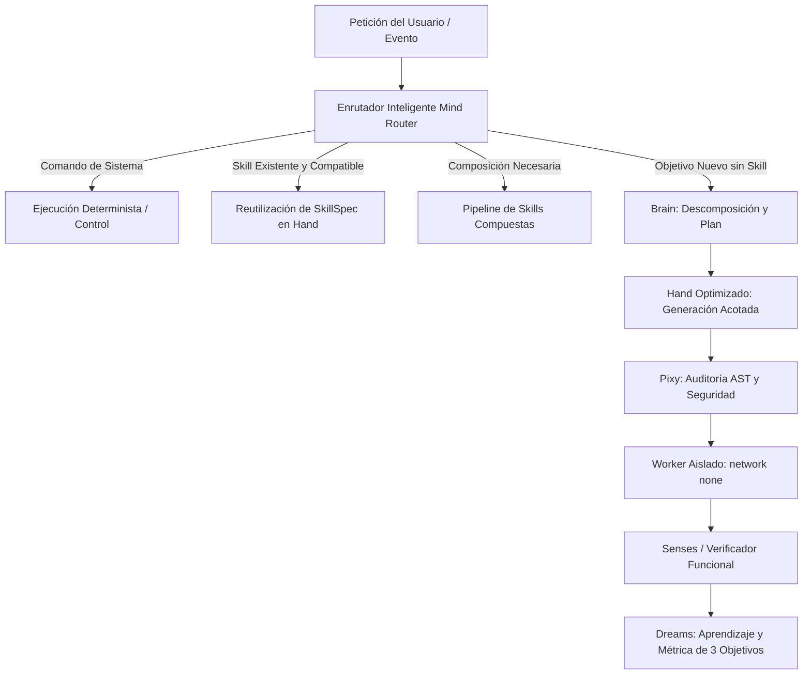

# Estado de la Arquitectura, Migración y Roadmap de Khai

**Fecha de corte:** 28 de octubre de 2026  
**Responsables técnicos:** Carlo (Principal Engineer) & Software Architect / SRE Agent  
**Estado general:** Fases 0 a 4 completadas. Fase 5 (Aprendizaje y Verificación) en curso. `app/common` y `legacy_learning` erradicados.

> **Fuente de verdad y despliegue:** `README.md`, `.agents/GEMINI.md` y `plan.md`
> son las fuentes principales. `plan.md` documenta el corte histórico F4; este
> roadmap amplía el estado operativo vigente, pero no reemplaza esas fuentes.
> El despliegue está congelado: no se actualizará Azure hasta terminar las
> mejoras, completar la validación de cierre y confirmar que el servicio actual
> no se rompe.

---

## 1. Lo que hemos hecho (Trabajo Completado)

### 1.1. Limpieza de Deuda Técnica y Erradicación de Antipatrones
- **Eliminación de artefactos heredados:** Eliminación definitiva de `modules/`, `orchestrator.py` y `publisher.tar.gz`.
- **Erradicación de `app/hand/forge.py`:** Purga del componente huérfano SkillForge, reemplazado por la arquitectura modular de Hand (`app/hand/hand.py`, `catalog.py`, `skill_spec.py`).
- **Erradicación del antipatrón `app/common`:**
  - Código de dominio redistribuido a sus órganos correspondientes:
    - [app/heart/catalog.py](../app/heart/catalog.py): planes declarativos, hashing, acciones y taxonomía causal determinista.
    - [app/voice/files.py](../app/voice/files.py): utilidades de lectura de archivos y buffers.
    - [app/voice/gateway/telegram_gateway.py](../app/voice/gateway/telegram_gateway.py): lógica de reintentos de red incrustada.
  - Creación formal del sustrato técnico en [app/kernel/](../app/kernel/):
    - `database.py`: gestor de conexiones SQLite, modo WAL y transacciones.
    - `events.py`: emisor y registro durable de eventos del sistema.
    - `control_plane.py`: puertos acotados (`HeartPort`, `HandPort`, `VoiceSecretsPort`, `CredentialStatusPort`).
    - `migration.py`: motor de migraciones versionadas por componente.
    - `tracing.py`: propagación de contexto y `trace_id`.
  - Eliminación física de `app/common/` y actualización de imports en más de 30 archivos.

---

### 1.2. Fase 4: Médico Único y Corrección Causal (A02, A03, A07, A13)
- **Taxonomía Determinista y Deduplicación Causal (Paso 1):**
  - Definición de `CAUSE_TAXONOMY` y fingerprinting causal determinista mediante `cause_fingerprint()` en [app/heart/catalog.py](../app/heart/catalog.py).
  - Implementación de `Recovery.classify_cause()` y `Recovery.open_incident_case()` en [app/heart/recovery.py](../app/heart/recovery.py).
  - Deduplicación estricta por `(task_id, run_id, cause_fingerprint)` evitando saturación de casos ante reintentos.
  - Migración 3 en `recovery_cases` para almacenar `incident_key`, `cause_code`, `task_id` y `run_id`.
  - Corrección de la anomalía A07 en `diagnose()`: selección de la tarea fallida más reciente en lugar de la más antigua.
- **Desacople de Diagnósticos Paralelos (Paso 2):**
  - **Pixy ([app/pixy/pixy.py](../app/pixy/pixy.py)):** Eliminación del diagnóstico LLM paralelo. Pixy delega 100% de consultas médicas a Heart vía `open_case()`.
  - **Coordinator ([app/mind/coordinator.py](../app/mind/coordinator.py)):**
    - Apertura automática de casos en `RUNNING` y `VERIFYING` mediante `heart.recovery.open_incident_case()`.
    - Eliminación de `mind.process_message()` en el estado `DIAGNOSING`: consumo directo de los planes declarativos formulados por Heart.
- **Erradicación del Falso `RECOVERED` y Ciclo Causal Completo (Paso 3 - A02/A03):**
  - Eliminación de `'RECOVERED'` del conjunto `TRANSITIONS['AUTHORIZED']` en [app/heart/recovery.py](../app/heart/recovery.py). La máquina de estados impide transiciones prematuras al autorizar un plan.
  - Flujo causal estricto:
    1. `AUTHORIZED` $\rightarrow$ `HAND_EXECUTING`: Heart invoca `coord.retry_task()` y registra la ejecución en estado `running`.
    2. `HAND_EXECUTING`: Heart monitorea la tarea en el `ControlStore`. Mientras esté ejecutando o generando, permanece en `HAND_EXECUTING`. Al alcanzar un estado terminal (`COMPLETED`, `FAILED`, `EXHAUSTED`, `CANCELLED`), transiciona a `VERIFYING`.
    3. `VERIFYING`: Heart audita que la tarea esté en `COMPLETED` y con evidencia de éxito verificada (`verified_success`). Solo en ese caso transiciona a `RECOVERED`; en caso contrario transiciona a `FAILED`.

---

### 1.3. Fase 5 (Inicio): Unificación de Dreams y Erradicación de `legacy_learning.py`
- **Eliminación de `app/dreams/legacy_learning.py`:** Purga del shim histórico.
- **Consolidación en [app/dreams/dreams.py](../app/dreams/dreams.py):**
  - Registro durable e idempotente en `task_observations` y sincronización con `control_feedback`.
  - **Requisito de 3 objetivos independientes:** La consolidación de habilidades e hipótesis exige $\ge 3$ `task_id` distintos con resultado exitoso y $\ge 80\%$ de tasa de éxito.
  - **Ciclo de vida y degradación de reglas:** Registro en `rule_uses`. Deprecación automática de reglas si acumulan $\ge 3$ usos y su tasa de éxito cae a $\le 30\%$ mediante `Rules.deprecate()` en [app/pixy/rules.py](../app/pixy/rules.py) y emisión del evento `dreams:rule_deprecated`.
  - **Desacople transaccional:** Transacciones SQLite aisladas de llamadas externas (`Rules`, `MemoryEngine`, `Events`), eliminando bloqueos de base de datos (`database is locked`).
  - **Corrección en `MemoryEngine` ([app/mind/memory.py](../app/mind/memory.py)):** Inicialización de la tabla `hypothesis_contexts` en `_init_db()`.
- **Validación con Batería de Pruebas Automatizadas:**
  - `tests/test_f5_dreams.py`: 4/4 pasadas.
  - `tests/test_control.py`: 41/41 pasadas.
  - `tests/test_f4_recovery.py` y `tests/test_recovery.py`: 22/22 pasadas.
  - `tests/test_architecture.py`: 30/30 pasadas.

---

## 2. Lo que queda por hacer (Trabajo Pendiente del Plan)

### 2.1. Fase 5 (Continuación): Verificación y Oráculos Funcionales Tipados
- **Implementado localmente:** verificación técnica tipada de archivos, JSON y
  recibos HTTP; un código de salida exitoso no acepta por sí mismo el objetivo.
  Las recetas ejecutan acciones tipadas dentro de un solo `task_id`. La revisión
  final del propietario decide satisfacción; sus correcciones conservan recibos
  anteriores como provisionales y añaden un presupuesto de skill sin reiniciar
  consumo. Voice no juzga calidad.
- **En curso:** comprobar la selección y composición de acciones con contratos
  HTTPS representativos. La aprobación única de primera configuración, la
  reutilización de permisos por alcance y la confirmación previa de variables
  ya están implementadas localmente; falta validarlas de extremo a extremo.
  La corrección se limita al efecto
  cuestionado; los demás recibos esperan la aceptación final. Mind usa preguntas
  declaradas por el contrato correctivo para pedir solo datos pertinentes que
  falten antes de ofrecer actualizar, crear con riesgo de duplicado o cancelar.
- **Contrato local para lotes:** Voice guarda un recibo por posición de entrada
  usando índices explícitos, estado individual e ID único por éxito declarado
  en `effect_contract.batch`. Los elementos faltantes o ambiguos quedan
  `unknown` y no se reenvían automáticamente; Mind detiene la receta e impide
  aceptar el lote incompleto. Falta validarlo con servicios
  reales. Para una operación `create` sin identidad o corrección verificable, el propietario puede
  autorizar expresamente una nueva creación con riesgo de duplicado; Voice admite
  una sola nueva petición de la misma operación/version por decisión. Una futura
  bóveda de Pixy con tokens acotados queda como propuesta, sin mover la actual
  custodia de credenciales de Voice.
- **Resumen por escritura decidido localmente:** Hand declara nombre y contexto
  fijos en el descriptor; Pixy los presenta para aprobación humana y Voice los
  conserva por recibo. Mind los muestra para aclarar varias escrituras. No se
  derivan de parámetros o contenido de la operación.
- **Respuesta final de recetas:** Mind presenta resultados por acción en lenguaje
  legible. Solo afirma un envío a un destinatario concreto si Voice tiene un
  recibo de escritura completado y el hash del destinatario enviado coincide
  con el valor confirmado. La aceptación final del objetivo sigue requiriendo
  un único `y` posterior al efecto.
- Las pruebas focales `tests.test_f5_setup_and_inputs`,
  `tests.test_f5_http_receipts`, `tests.test_f5_recipe_execution` y
  `tests.test_f5_reusable_skill_approval` pasaron 36/36 en conjunto. Falta validación
  integral de cierre; no se ha desplegado.
- **Siguiente bloque:** integrar una receta de lectura y escritura (por ejemplo,
  noticias y correo) con contratos HTTPS representativos y sin credenciales
  productivas. Verificar confirmación de valores, configuración inicial,
  reutilización autorizada, recibos técnicos y respuesta legible; contrastar
  también lotes con respuestas parciales.

### 2.2. Fase 6: Validación en Linux y Entorno Docker/Compose
- **Validación en Host Linux:**
  - Pruebas de aislamiento real de workers con `--network none`, sistema de archivos de solo lectura y mounts estrictos.
  - Validación de LocalRuntime bajo Bubblewrap (aislamiento por user namespaces).
  - Pruebas de fault injection: parada forzada de proxy y daemon Docker, recuperación transaccional sin repetición de efectos colaterales.
- **Canario y Entrega Durable:**
  - Canario con Telegram real mediante outbox/inbox durable.
  - Supervisión externa con watchdog acotado.

### 2.3. Fase 7: Experimento de Evolución y Promoción Controlada
- Circuito formal de propuestas de evolución del mecanismo (`EvolutionProposal` / `Experiment`).
- Evaluación independiente sobre banco reservado de pruebas sin que el constructor (Hand) controle al evaluador.

### 2.4. Limpieza de Scripts Auxiliares
- Archivar o depurar [scripts/migrate_architecture.py](../scripts/migrate_architecture.py) y scripts temporales en [scripts/](../scripts/).

---

## 3. Hoja de Ruta: Optimización de Hand, Brain Ampliado y Enrutador Inteligente

Como parte de la visión técnica definida por Carlo, se establece la hoja de ruta para potenciar **Hand**, el **Cerebro (Brain)** y el **Enrutador de Intenciones**:

### 3.1. Optimización de Hand (`app/hand/`)
1. **Generación Especializada y Reducción de Latencia:**
   - Plantillas de código base ultra-ligeras optimizadas para Python 3.11+.
   - Eliminación de boilerplates innecesarios; generación orientada estrictamente al contrato de entrada (`khai_input.params`) y salida (`khai_output`).
2. **Catálogo de Habilidades y `SkillSpec` Formal:**
   - Versionado semántico formal (`v1.0.0`) y empaquetado inmutable (`spec_hash`).
   - Separación estricta entre **artefactos circunstanciales** (scripts de una sola vez) y **habilidades generales reusables** promocionadas por el usuario.
3. **Manejo Idempotente de Dependencias y Servicios:**
   - Descriptores de servicio pre-aprobados para lectura pública y control de autorización humana para escrituras en [app/voice/gateway/service_registry.py](../app/voice/gateway/service_registry.py).

### 3.2. Cerebro Ampliado (`Brain` y `LLMManager`)
1. **Multi-Proveedor con Fallback Determinista:**
   - Pool de claves con rotación, estado de cooldown (`provider_status`) y preservación de presupuestos (`llm_calls`).
   - Conexión balanceada entre modelos de alta capacidad (razonamiento/arquitectura) y modelos rápidos (análisis sintáctico/extracción).
2. **Generación Estructurada (JSON Schema / Structured Outputs):**
   - Garantía sintáctica de respuestas para manifiestos, diagnósticos y parámetros, eliminando fallos de parsing por markdown o texto conversacional.
3. **Inyección Contextual Just-In-Time:**
   - Inyección precisa de directrices y memoria por tags de contexto (`context`, `capabilities`), evitando bombas de contexto que degraden la atención del modelo.
4. **Catálogo de Habilidades Nativas (Tools):**
   - Interfaz de tool calling formal acotada al protocolo de Hand y Voice sin exponer socket del sistema ni credenciales.

### 3.3. Enrutador Inteligente (`Router` / `SkillSelector` / `Mind Routing`)
1. **Clasificación Rápida de Intenciones en Estado `ROUTING`:**
   - Fase de enrutamiento determinista de baja latencia previa a cualquier consumo de LLM.
2. **Estrategia Híbrida de Enrutamiento:**
   - **Nivel 1 (Comandos Deterministas):** Atiende comandos administrativos (`/approve`, `/verify`, `/tasks`, `/service`, `/status`) sin costo cognitivo.
   - **Nivel 2 (Coincidencia Semántica con Embeddings Locales):** Uso de `SkillSelector` con embeddings locales (`sentence-transformers` o modelo configurado) para evaluar similitud contra el catálogo de `SkillSpec` activas, aplicando umbral de corte y margen de desempate.
   - **Nivel 3 (Composición de Habilidades):** Identificación de objetivos que pueden resolverse encadenando dos o más habilidades existentes sin generar nuevo código.
   - **Nivel 4 (Generación en Hand):** Solo si no existe ninguna habilidad compatible en catálogo, se deriva a Brain y Hand para generación de código nuevo.
3. **Aislamiento de Decisión:**
   - El enrutador sugiere y prepara la ruta, pero la ejecución queda sujeta a la política de seguridad de Pixy y al control de presupuestos del Control Plane.
