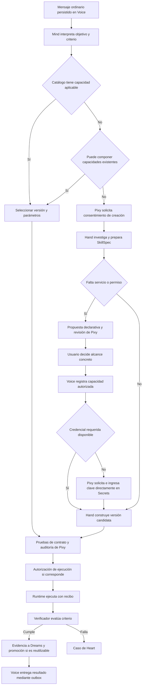
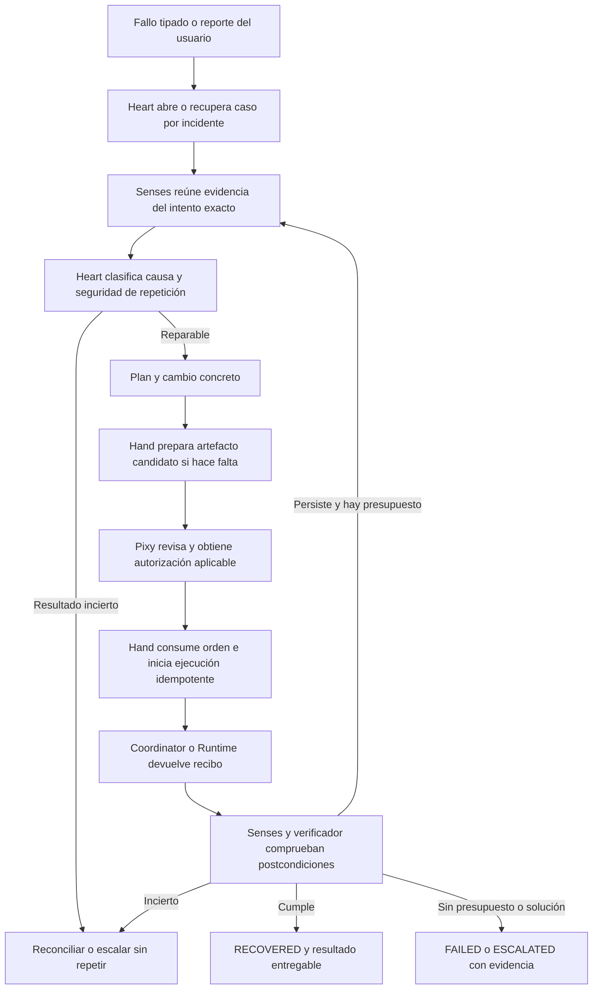
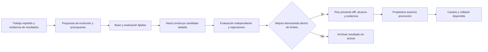

# Plan de Khai: aprender, reparar y evolucionar con autoridades separadas

Creación: 25 de octubre de 2026. Actualización: 26 de octubre de 2026. Base auditada: revisión `d8dc31d` y [auditoría de flujos](AUDITORIA_FLUJOS_2026-10-25.md).

Este documento propone cambios; no declara que estén implementados ni autoriza su despliegue. Los identificadores A01–A15 remiten a hallazgos de la auditoría. Incorpora la discusión posterior sobre Voyager, Agent Zero, Letta, OpenHands, Darwin Gödel Machine y LangGraph, y la decisión del usuario de consolidar código y estado sin fusionar autoridades. Los detalles de esos proyectos son referencias para estudiar, no garantías transferidas a Khai.

Esta revisión sustituye la recomendación de una base de control por órgano por un monolito modular con registro transaccional común; distingue aprendizaje, reparación y evolución; y establece que **Pixy solicita e ingresa las claves directamente en Secrets mediante un flujo determinista que excluye al LLM y a Hand**. La auditoría se conserva como fotografía de la revisión examinada.

## 1. Objetivo y criterio de éxito

Ante una necesidad nueva, Khai debe buscar capacidades existentes, parametrizarlas y componerlas antes de generar código. Si sigue faltando una capacidad, solicita consentimiento de creación, investiga lo necesario, produce una herramienta, revisa y autoriza su alcance, la ejecuta, verifica su resultado y lo entrega. El código circunstancial queda como artefacto del intento; su promoción a habilidad reutilizable exige un contrato y evidencia de aplicabilidad.

Ante un fallo, Heart debe abrir un caso ligado a ese objetivo e intento, obtener evidencia de Senses, distinguir la causa, preparar un plan concreto, obtener la autoridad necesaria mediante Pixy, pedir a Hand una corrección y comprobar el resultado. Un reintento por sí solo nunca cierra el caso como recuperado.

Las tres finalidades se evalúan por separado:

| Finalidad | Resultado buscado | Evidencia de aceptación | No basta con |
| --- | --- | --- | --- |
| **Aprender** | Resolver situaciones equivalentes evitando trabajo que antes hubo que descubrir, generar o corregir | Recuperar/componer la capacidad correcta, menos generaciones/diagnósticos repetidos, igual o mejor calidad y adaptación de parámetros | Más notas, reglas, archivos o ejecuciones acumuladas |
| **Reparar** | Restablecer el objetivo o condición operacional que falló | Postcondición original satisfecha por un intento identificado, con causa y efectos reconciliados | Reencolar, reiniciar o anunciar recuperación |
| **Evolucionar** | Mejorar el mecanismo del agente para una familia de problemas | Variante candidata comparada con una base, mejora en casos reservados, regresiones controladas, promoción y reversión auditadas | Corregir un único caso o modificar el propio código |

Una reparación puede producir una lección; esa lección solo demuestra aprendizaje cuando se utiliza con éxito después. Una propuesta de evolución puede nacer de esos eventos, pero necesita su propio experimento y autorización. Mantener independencia entre quien construye el cambio, quien autoriza y quien comprueba el resultado.

La aceptación principal será una demostración repetible en Linux: crear una capacidad externa, recibir una clave mediante Pixy si hace falta, verificarla, inducir un fallo reparable, corregirlo y reutilizarla con otra redacción y parámetros. Después, un experimento aislado debe evaluar una mejora del mecanismo sin alterar las pruebas para favorecerla. El catálogo inicial puede estar vacío; incorporar un servicio no debe requerir editar el código del Core.

## 2. Decisiones de arquitectura recomendadas

| Decisión | Recomendación | Motivo / consecuencia |
| --- | --- | --- |
| Runtime | Mantener Docker/LocalRuntime y órganos actuales | Ya hay persistencia, aislamiento y versionado aprovechables; una migración completa agrega riesgo sin resolver los contratos |
| Organización | Monolito modular del Core; consolidar infraestructura común y duplicaciones | Los órganos representan autoridades lógicas, no procesos, bases o agentes LLM obligatorios |
| Reglas deterministas | Centralizar schemas, transiciones, política, presupuestos, permisos y verificación objetiva | El LLM propone; las decisiones de autoridad y los hechos persistidos se validan en código |
| Estrategia de solución | Buscar → parametrizar → componer → generar → verificar → promover cuando corresponda | Evita crear una skill nueva por cada petición equivalente |
| Red de workers | Mantener `network none`; usar Voice | Protege secretos y da un punto verificable de políticas, cuotas y recibos |
| Nuevos servicios | Descriptores declarativos propuestos por Hand, revisados por Pixy y registrados por Voice | Cumple crecimiento autónomo sin APIs de negocio hardcoded ni permiso general de Internet |
| Diagnóstico | Heart posee el caso; Brain puede proponer hipótesis estructuradas | La inteligencia del modelo asiste al médico; no reemplaza estados, evidencia o autoridad |
| Ejecución de remediación | Hand posee la orden y el artefacto; Runtime o Coordinator son adaptadores de ejecución | Hand no debe escribir directamente tablas privadas de otros órganos |
| Permisos | Una API de decisiones durables y tipos de autorización separados | Unifica garantías sin confundir crear una skill con ejecutar un efecto externo |
| Claves | Pixy pide y guarda directamente mediante la API determinista de Secrets; Voice las usa solo en transportes aprobados | El valor no pasa por Brain, LLM, Hand, memoria, eventos o workers |
| `trace_id` | Solo correlación | Ningún permiso se deduce de compartir una traza |
| Persistencia | Una SQLite de control para objetivos, intentos, casos, permisos, órdenes y metadatos operativos | La aprobación y la habilitación de su orden pueden ser atómicas; tablas/repositorios conservan propietario lógico |
| Fronteras externas | Recibos propios del proxy/runtime y outbox/inbox para mensajes y efectos fuera del control store | Unificar el Core no convierte Docker, Secrets, archivos o proveedores en una transacción SQLite |
| Éxito | Resultado verificado, caso recuperado y entrega son hechos diferentes | Permite éxito funcional con entrega pendiente, o proceso vivo sin objetivo verificado |
| Aprendizaje | Dreams exclusivamente por eventos | Las reglas siguen propuestas hasta aprobación; las degradadas pueden suspenderse según política explícita |
| Evolución | Candidatas en entorno aislado, comparadas antes de promoción | El agente no puede aprobar su propio cambio de política ni desplegarse por inferencia |

Estas decisiones resuelven las contradicciones documentales a favor del crecimiento autónomo controlado. Deben quedar registradas como ADR antes de codificar la ampliación de capacidades, junto con ejemplos admitidos y rechazados.

### Consolidación física y separación de autoridades

Unificar código significa compartir implementaciones de persistencia, eventos, validación, planificación de trabajo y render de respuestas. No significa dar a todos los órganos acceso a todas las mutaciones. Una fachada tipada de comandos aplica la política del propietario: Heart propone un plan, Pixy autoriza, Hand despacha y Coordinator valida la transición de la tarea. Las lecturas se exponen mediante vistas/consultas; las escrituras pasan por esa fachada, sin SQL arbitrario entre módulos.

El registro común incluye decisiones, órdenes, estados de tareas/casos, referencias de evidencia, metadatos de versiones/capacidades, propuestas de reglas/evolución e inbox/outbox. Los artefactos quedan en disco por hash; las memorias pueden tener su propio índice; los secretos quedan fuera de la base común. El proxy conserva recibos independientes porque debe operar y reconciliarse incluso con el Core detenido. Ningún índice o caché puede convertirse en una segunda autoridad del mismo estado.

No crear microservicios ni un framework genérico nuevo para materializar la metáfora. Consolidar primero los caminos duplicados de generación, permisos, diagnóstico y aprendizaje. Los adaptadores heredados se mantienen delgados hasta que sus consumidores y el despliegue migren; luego se retiran con pruebas. La separación dentro del proceso es una garantía de diseño y validación, no aislamiento frente a código arbitrario comprometido: el código generado continúa fuera del Core, en workers aislados.

| Función | Implementación principal | Intervención posible del modelo |
| --- | --- | --- |
| Autenticación, permisos y captura de claves | Determinista, identidades/alcances exactos | Ninguna sobre valores de claves o concesión de autoridad |
| Estados, presupuesto, deduplicación y scheduling | Máquina de estados y comandos tipados | Proponer acciones, nunca forzar transiciones |
| Observación y verificadores objetivos | Adaptadores de lectura y evaluadores independientes | Interpretar evidencia sanitizada o señalar incertidumbre |
| Intención, composición y código nuevo | Búsqueda/contratos más Brain y Hand | Proponer selección, composición o artefactos |
| Diagnóstico | Taxonomía determinista, catálogo y Heart | Hipótesis cuando la evidencia no determina la solución |
| Consolidación y evolución | Eventos, métricas y revisión de candidatas | Proponer lecciones/cambios sin autoaprobarlos |

### Autonomía según alcance

Pixy puede aplicar permisos persistentes que el propietario haya concedido para operaciones conocidas, con alcance, límites, vencimiento y revocación explícitos. No se deducen permisos permanentes de un `y` anterior. Crear una habilidad nueva mantiene el consentimiento de creación; reutilizar una versión aprobada dentro de su alcance puede evitar preguntas repetidas. Cambiar contenido, efectos, destinos o privilegios exige evaluar otra vez la autoridad aplicable. Aprender no amplía permisos.

### Tres alcances de autorreparación

| Alcance | Puede hacer Khai | Frontera |
| --- | --- | --- |
| Herramienta / tarea | Corregir parámetros, generar nueva versión, adaptar uso de SDK, reejecutar cuando el efecto es reconciliado o seguro | Presupuesto, aprobación y verificación del objetivo original |
| Operación del sistema | Actuar sobre un catálogo cerrado: reconciliar recibos, restablecer un componente conocido, restaurar una versión verificada | Plan concreto, targets exactos, cooldown y recibo; ninguna shell arbitraria |
| Código del Core / host | Diagnosticar, proponer patch y regresión en entorno de desarrollo aislado | Cambios al Core, permisos estructurales y despliegue se revisan como cambio de software; el worker no se modifica privilegios |

Un supervisor externo mínimo debe poder detectar un Core completamente muerto. Esto no convierte al agente en administrador general del host. Un componente que no está ejecutándose no puede curarse a sí mismo desde su propio loop.

## 3. Responsabilidades finales por órgano

| Órgano | Responsabilidad y API conceptual | No debe hacer |
| --- | --- | --- |
| Mind / Coordinator | Interpretar objetivo; elegir skill candidata; conservar lifecycle, revisiones y presupuestos; validar órdenes de transición | Diagnosticar fallos por un camino paralelo a Heart o reiniciar presupuestos |
| Brain | Producir propuestas estructuradas de intención, código y diagnóstico a través de interfaces acotadas | Autorizar, afirmar evidencias nuevas o escribir estados finales |
| Heart | Abrir/correlacionar casos; pedir evidencia; formular RepairPlan; seguir intento corregido; verificar recuperación | Activar artefactos, ejecutar Docker o declarar éxito por encolar |
| Hand | Componer/crear/cambiar/empaquetar versiones y candidatas de evolución; producir SkillSpec y descriptores; ejecutar órdenes autorizadas | Leer, recibir o guardar claves; aceptar permisos por traza; aprobar su propio cambio |
| Pixy | Preflight, política y autorizaciones; canal de supervisión; solicitar claves y escribirlas directamente en Secrets por un handler determinista | Pasar valores de claves al modelo, Hand o historial; sustituir a Heart como médico |
| Voice | Transporte de entrada/salida, HTTP mediado, Runtime y AssetGateway; custodiar el servicio Secrets y resolver claves para operaciones aprobadas | Incluir claves en inbox conversacional, prompts, recibos públicos o workers; conceder permisos por texto LLM |
| Senses | Evidencia estructurada antes/después con procedencia y vigencia | Mutar el sistema observado; puede registrar su propia evidencia de observación |
| Dreams | Evaluar evidencia; proponer/suspender recomendaciones; identificar mejoras candidatas del mecanismo a partir de trabajo repetido | Convertir reflexión en éxito, aprender de `started`, activar reglas o modificar permisos por su cuenta |

## 4. Flujos de destino

### Creación y reutilización



El consentimiento de crear habilita preparación, generación y descubrimiento dentro de la política existente. No autoriza automáticamente un POST, una credencial, nuevos dominios o una mutación externa. La aprobación sensible debe mostrar el artefacto y alcance concretos; si se cambian, se invalida lo que ya no coincide.

La comprobación de credenciales también se aplica a capacidades existentes y compuestas antes de ejecutarlas. Entregar una clave a Pixy autoriza guardarla para el propósito presentado; no autoriza otras operaciones externas. Si falta, se conserva la tarea en `WAITING_SECRET` con una solicitud identificada, sin consumir generaciones ni iniciar un objetivo nuevo.

### Recuperación



`RETRY_SCHEDULED` o `REPAIR_RUNNING` son estados intermedios. `RECOVERED` exige vincular la verificación al intento nuevo y comprobar la condición que motivó el caso. Recuperar infraestructura y completar el objetivo del usuario son dos verificaciones diferentes, aunque estén relacionadas.

### Evolución del mecanismo



El experimento tiene identidad y presupuesto propios y conserva relación con los casos que lo motivaron. La candidata no modifica la base de comparación, el conjunto reservado de pruebas, sus permisos ni los criterios de aceptación. Una mejora de infraestructura del host/Core usa el procedimiento de cambio y despliegue; un cambio de skill/procedimiento usa su política de promoción. No ejecutar búsqueda evolutiva indefinida ni habilitarla mediante un temporizador de Dreams.

## 5. Contratos y datos necesarios

Los nombres son propuestas de diseño. Reutilizar tablas existentes donde sea coherente; evitar duplicar almacenes con el mismo propietario.

| Contrato | Campos mínimos | Invariantes |
| --- | --- | --- |
| Goal | goal/task ID, petición original, entrada normalizada, criterio, límites, consumos, deadline, revision | Los intentos no reemplazan el objetivo ni borran su coste |
| Attempt | attempt/run ID, goal ID, parent attempt, versión/hash, entradas, error, recibo, evidencia, presupuesto consumido | Historial inmutable; nueva ejecución tiene identidad nueva salvo replay del mismo envío |
| SkillSpec | skill ID estable, descripción, casos de uso, input/output schema, código/bundle, runtime, deps, servicios, verificadores, procedencia | Separa capacidad reutilizable de parámetros de una solicitud |
| RuntimeCapabilities | runtime y versión, modos, dependencias permitidas, filesystem, API de gateway, límites | Hand solo genera contra facultades reales; no deducidas del manifiesto |
| ServiceDescriptor | servicio/operación, origen HTTPS, método/ruta, esquema de parámetros/respuesta, efecto, credencial referenciada, límites y versión | Contiene referencias, nunca valores de Secrets; propuesta nueva no está activa |
| SecretRequest | request ID, owner, tarea/operación, secret ref, propósito, tipo de clave, expiry, versión esperada, estado | Metadatos únicamente; Pixy captura el valor fuera del flujo conversacional y lo escribe en Secrets |
| SecretReceipt | request ID, secret ref/version, resultado de guardado/validación y fecha | Sin valor, prefijo, hash del valor ni excepción con credenciales; permite reconciliar sin volver a mostrar la clave |
| ApprovalRequest | approval ID, tipo, owner/chat, sujeto/revision, manifest/plan/bundle hash, policy version, expiry, status | Crear, ejecutar, extender presupuesto y remediar son decisiones identificables |
| Authorization | approval ID, executor, sujeto, acción/targets, hashes, nonce, expiry, consumer/operation ID | Alcance exacto; consumo atómico; replay solo de la misma operación |
| RecoveryCase | case/incident ID, goal/run, fingerprints de causa, fase, evidencia, plan revision, autorización, intentos y verificación | Un incidente tiene un caso activo; no se cierra por encolar |
| RepairPlan | plan ID/revision, sujeto exacto, diagnóstico sustentado, cambio propuesto, pasos tipados, pre/postcondiciones, riesgo, compensación, coste | El hash cubre task/version/argumentos/capacidades, no solo `target=task` |
| EvolutionProposal | propuesta, objetivo medible, casos fuente, baseline, tipo de cambio, presupuesto y límites | Aprendizaje o reparación previa no acreditan mejora general |
| EvolutionExperiment | candidata/hash, baseline/hash, suite/version, conjunto reservado, recursos, resultados/regresiones, decisión y rollback | Evaluación independiente; promoción requiere evidencia y autoridad |
| Evidence | evidence ID, source, observed_at, boot ID, trace/task/case/run, payload hash, resultado y vigencia | Lo ausente o viejo se representa como desconocido, no como sano |
| DomainEvent | event ID, schema version, correlation/causation, aggregate ID/revision, payload resumido | Consumidor idempotente; entrega al menos una vez sin repetir mutaciones |
| Delivery | delivery ID, resultado asociado, canal, mensaje preparado, intentos, recibo, estado | Completar cómputo no implica que el usuario recibió el mensaje |

### Estados y transacciones

1. Centralizar las transiciones permitidas y validar `expected_revision` además del estado. Una orden de reparación vieja no puede revivir una cancelación nueva.
2. En el control store común, persistir decisión, reserva de autorización y habilitación de la orden mediante una unidad de trabajo que invoque las validaciones de sus propietarios. No usar mensajes entre bases para pasos que ya pueden confirmarse juntos. Para notificaciones, proxy, archivos y otros efectos externos, persistir intención/outbox y reconciliar recibos; cada consumidor deduplica por ID.
3. Reconciliar al arrancar todos los estados intermedios. No limitar el scheduler a la parte posterior a `AUTHORIZED`.
4. Reservar el permiso para una operación concreta antes del efecto. Reanudar una operación ya reservada utiliza el mismo ID; no requiere gastar un permiso nuevo ni vuelve a lanzar efectos confirmados.
5. Separar `goal_state`, `process_state`, `verification_state` y `delivery_state`. Un AGENT vivo debe conservar mailbox, deadline y cancelación aunque su resultado esté `UNVERIFIED` o verificado.
6. Mantener checkpoints como ayuda, sin tratarlos como transacción con servicios externos. Las mutaciones externas requieren clave de idempotencia soportada por el proveedor o reconciliación posterior.
7. El ingreso de credenciales se desvía antes de la persistencia del mensaje ordinario. Persistir solo metadatos del SecretRequest/SecretReceipt. La escritura de Secrets se confirma atómicamente en su propio almacén y se reconcilia por ID/versión con el control store; nunca guardar temporalmente el valor en su outbox.
8. Separar ventanas de espera humana de tiempo de ejecución y mantener un límite total explícito. `WAITING_SECRET` y las aprobaciones tienen vencimiento; entregar una clave o resolver un permiso retoma el punto suspendido con su presupuesto conservado.

### Diagnóstico y política de reintentos

| Clase de fallo | Evidencia esperada | Acción preferente | Condición de repetición |
| --- | --- | --- | --- |
| Sintaxis / código | Error de parser o recibo de proceso | Hand crea nueva versión con feedback | Presupuesto de reparación disponible |
| Política o capacidad ausente | Rechazo tipado con capability/service ID | Resolver capacidad o pedir decisión; no regenerar a ciegas | Permiso/capacidad efectiva nueva |
| Dependencia | Build/import, versión y runtime | Corregir lock o usar alternativa soportada | Construcción autorizada y entorno compatible |
| Proveedor temporal | HTTP 429/5xx, Retry-After, timeout clasificado | Backoff acotado/circuit breaker | Evidencia de lectura o de no inicio del efecto |
| Credencial | Ausencia o rechazo tipado; 401/403 no implica siempre clave inválida | Pixy solicita la clave si procede y la guarda directamente en Secrets; Voice valida el uso permitido sin exponerla | Referencia/versión disponible y alcance aprobado; no regenerar el código por falta de clave |
| Resultado inválido | Fallo de verificador con contraejemplo | Corregir lógica/parámetros | Criterio original conservado |
| Efecto incierto | Envío sin recibo, escritura parcial | Consultar estado del proveedor o escalar | Confirmación de no ejecución o operación idempotente |
| Infraestructura | Readiness, cgroup, daemon, recibos | Remedio operacional del catálogo | Target exacto, cooldown y ausencia de corrupción |
| Presupuesto agotado | Contadores y plazo | Entregar diagnóstico o pedir extensión concreta | Extensión registrada; nunca poner consumos a cero |

Los valores actuales de 4 generaciones, 4 ejecuciones, 16 intentos LLM y 30 minutos se conservan inicialmente como límite del objetivo. Definir un subpresupuesto de diagnóstico/remediación dentro del total. Una ampliación autorizada suma límites y tiempo; el gasto anterior permanece. Fijar después backoff, cooldown y límites de reinicio usando mediciones, no para ocultar fallos estructurales.

## 6. Crecimiento autónomo de capacidades externas

Este es el cambio que resuelve la tensión entre «sin APIs hardcoded» y «workers sin Internet».

1. **Descubrir capacidad existente:** Voice publica descriptores y estado de disponibilidad; Hand recibe únicamente las operaciones pertinentes y su SDK efectivo.
2. **Investigar cuando falta:** ofrecer una primitiva genérica de búsqueda/lectura de documentación pública a través de Voice con política explícita. Si necesita un proveedor de búsqueda, configurarlo una vez como capacidad de plataforma; no programar cada API de negocio. Si falta una clave necesaria, Pixy abre el flujo directo de Secrets; mientras tanto pueden continuar las lecturas públicas autorizadas que no dependan de ella.
3. **Tratar las fuentes como datos:** registrar URL, fecha y evidencia; texto externo no modifica instrucciones, permisos ni endpoints por sí mismo.
4. **Proponer el servicio:** Hand produce un descriptor estructurado con origen HTTPS, paths o plantillas acotadas, métodos, parámetros, esquema de respuesta, propósito, credencial por referencia, coste y clase de efecto. Debe mostrar exactamente qué se autoriza.
5. **Revisar y aprobar:** Pixy valida esquema, destino y alcance; la aprobación se vincula al hash del descriptor. Solicitudes con mutaciones externas tienen política distinta de lecturas públicas.
6. **Activar:** Voice registra una versión aprobada del descriptor mediante una operación del Core tipada. El YAML puede quedar como semilla de migración; no es el mecanismo normal para agregar cada servicio.
7. **Resolver credenciales:** Pixy solicita y guarda directamente en Secrets las claves faltantes. El descriptor y Hand solo conocen referencias; Voice resuelve el valor dentro del transporte autorizado. Reanudar el mismo objetivo tras el recibo de disponibilidad.
8. **Componer, generar y probar:** Hand utiliza operaciones existentes y `khai_gateway.request(service, operation, params)` con los descriptores efectivos. Ejecutar primero contra fixtures y luego una lectura real acotada cuando corresponda.
9. **Revocar o actualizar:** un descriptor modificado vuelve a revisión; una skill dependiente queda incompatible o pendiente de revalidación si cambia su contrato. La rotación de una clave mantiene el alcance del descriptor y obliga a refrescar su referencia/versión donde corresponda.

Mantener DNS público validado y fijado, TLS, rechazo de redirects, límites de tamaño/tiempo y acceso exclusivo de Voice a secretos. Vincular la autorización de red a operaciones concretas: el flag global `Network` por sí solo no debe permitir cualquier operación del catálogo, especialmente POST con efectos.

Una API que no se expresa con las primitivas disponibles se reporta como limitación real y produce una propuesta de extensión de plataforma. La autonomía no consiste en fingir soporte ni en ampliar silenciosamente el ejecutor.

### Ingreso directo de claves por Pixy

**Regla obligatoria:** si falta una API key, token, contraseña, certificado privado u otra credencial necesaria, **Pixy la solicita al propietario y la inserta directamente en Secrets con código determinista**. Hand y Brain nunca reciben el valor ni participan en su validación, escritura o resolución. Una referencia de credencial no es su contenido. La explicación de Pixy puede usar una plantilla sin LLM, incluso cuando la clave faltante es la del propio proveedor de IA.

El camino autorizado es:

```text
Necesidad de credencial (solo metadatos)
  → Pixy crea SecretRequest y muestra propósito/alcance
  → Propietario abre captura privada autenticada
  → Handler determinista de Pixy valida solicitud e identidad
  → Pixy llama directamente a Secrets.put(request_id, ref, value, expected_version)
  → Secrets devuelve recibo sin valor
  → Voice refresca la referencia y, si está autorizado, comprueba conectividad
  → Coordinator reanuda el mismo objetivo en su fase pendiente
```

La captura preferida es un formulario privado autenticado, identificado por la solicitud y con expiración; la URL no contiene el secreto. Telegram puede entregar el aviso/enlace. Si se habilita captura dentro del canal, debe ser una respuesta privada vinculada inequívocamente a SecretRequest, interceptada antes de Mind, del inbox ordinario y de cualquier logger de cuerpos. No pedir «pega tu clave» en una conversación que siga la ruta general. El compromiso de exclusión del LLM se aplica a este canal dedicado; detectar cualquier secreto arbitrario pegado fuera de él no es una garantía suficiente y debe tratarse como una protección adicional.

Requisitos del handler y del almacén:

- Registrar propietario, referencia, proveedor/uso aprobado, tipo, versión y estado; **no persistir el cuerpo sensible** en chats, eventos, memoria, trazas, artefactos o mensajes de error. Ni el request HTTP de validación ni sus cabeceras pueden aparecer en logs.
- Validar nombre/tipo/alcance mediante código. No permitir elegir rutas de archivo, introducir nuevas líneas en un formato env o crear variables con efectos sobre el arranque. Resolver tipos multilínea/binarios mediante serialización tipada, sin concatenaciones de shell o de archivos env.
- Autenticar, vencer y consumir la captura por request ID; replays no reemplazan otra clave. La rotación usa versión esperada y propósito explícito; una respuesta antigua no sobrescribe una rotación nueva. Tras cancelación de la tarea puede conservarse una clave ya guardada según la decisión presentada, pero no se reanuda la tarea cancelada.
- Añadir escritura segura a [Secrets](../app/voice/secrets.py), que hoy carga valores al iniciar y solo ofrece lectura. Mantener el almacén canónico bajo Voice: actualmente `data/voice/secrets.env`; usar almacenamiento privado tipado para claves no representables allí. Escritura atómica, bloqueo, permisos del sistema operativo y backups protegidos; los valores nunca se incorporan al control store común.
- Pixy administra la solicitud y la escritura por interfaz estrecha; Voice custodia y resuelve el secreto exclusivamente para la operación permitida. Unificar proceso/código no habilita acceso general a `Secrets.items()` desde otros órganos. LLM recibe como máximo estado `missing/available/invalid` y referencia no sensible.
- Confirmar únicamente «credencial guardada» o un error sanitizado. No mostrar ni parcialmente el valor, no enviarlo al modelo para comprobar formato, no usarlo como material de aprendizaje. Cualquier lectura de valor se restringe al adaptador de transporte o infraestructura que realmente lo necesita; un worker recibe el servicio mediado, nunca la clave.
- Si la clave autentica al proveedor LLM, únicamente el cliente de transporte de Voice puede usarla en su mecanismo de autenticación; nunca en mensajes, prompts o contexto del modelo. Sanitizar también respuestas y excepciones del proveedor antes de entregar datos a otros órganos; una respuesta que refleje la credencial no debe filtrarla al historial, al worker o al modelo.
- La disponibilidad de la clave y la autorización de uso son condiciones independientes. Guardar una clave no habilita destinos, acciones o permisos adicionales. Al rotar, refrescar de forma coordinada las cachés de secretos/clientes; probar el camino de recuperación tras caída entre escritura y recibo sin pedir otra vez el valor ya almacenado.

Las pruebas usarán claves ficticias marcadoras y capturarán los límites de prompts, logs, inbox, eventos, errores, código y entorno de worker. Deben demostrar ausencia del valor en todos ellos y presencia solo en Secrets y en el transporte explícitamente autorizado.

## 7. Verificación independiente de aprendizaje, reparación y evolución

### Verificadores

- Mantener SHA256 para archivos de contenido conocido.
- Añadir JSON Schema, invariantes de dominio, existencia/tipo de archivo y prueba funcional de servicio.
- Para datos externos dinámicos: comprobar procedencia, operación autorizada, esquema, ubicación/unidades y vigencia. Esas comprobaciones acreditan cumplimiento del contrato, no verdad universal del proveedor.
- Para recuperación: ejecutar de nuevo la comprobación que falló y verificar el síntoma original dentro de una ventana definida.
- Reservar verificación humana para resultados subjetivos o sin oracle suficiente. La explicación LLM puede ayudar a revisar, pero no es la única prueba.
- Fijar criterios antes del intento; Hand no puede cambiar el test para aprobar su propio código. Los cambios de criterio son decisiones explícitas con historial.

### Biblioteca y versiones

Separar `draft`, `reviewed`, `executable_candidate`, `verified` y `promoted`. Los nombres exactos pueden adaptarse a los estados existentes. Promover la nueva versión solo después de cumplir contrato; conservar y poder seleccionar la última versión verificada. Fallar una candidata no debe borrar el historial ni sustituir automáticamente una versión estable.

El catálogo identifica capacidades y parámetros, no frases completas. Mind puede sugerir candidatos mediante búsqueda semántica, pero se valida compatibilidad de schemas, runtime, servicios y permisos antes de invocar. Un resultado de búsqueda no concede autoridad.

Una skill incluye procedimiento, precondiciones, código si hace falta, contratos de entrada/salida, servicios requeridos por referencia, errores conocidos y verificadores. Recuperar primero metadatos y cargar detalles solo cuando sean necesarios. Una composición fija versiones de sus dependencias y vuelve a comprobar su compatibilidad; no oculta cambios de permisos detrás de una skill agregada. Los artefactos de un solo uso no se promocionan por el mero hecho de existir.

### Aprender por trabajo evitado

Separar hechos/preferencias, historial de intentos, procedimientos reutilizables e hipótesis. Cada elemento conserva procedencia, contexto, fecha y condición de vigencia. Una hipótesis del modelo no se convierte en un hecho de memoria; una clave nunca es memoria. Mantener separados el historial de auditoría y los índices que usa Mind para recuperar contexto.

El resultado de aprender debe observarse en una solicitud posterior: selección de una capacidad útil, composición correcta, menos generación y diagnóstico repetidos, sin perder calidad. Comparar solicitudes equivalentes y variaciones reservadas con los mismos límites; registrar cuándo una receta deja de aplicar. Contar menos trabajo solo si se obtiene el resultado requerido: saltarse comprobaciones o fallar antes no es mejora.

Guardar la causa de un fallo junto con las condiciones de la solución: «este contrato cambió de campo y esta versión lo maneja», en vez de una regla universal como «siempre reintenta». La reparación del caso original y la reutilización posterior deben tener observaciones separadas. Dreams propone consolidación a partir de sus eventos existentes, sin añadir un cron ni un agente autónomo permanente por cada órgano.

### Dreams

Consumir eventos `AttemptVerified` y `ProcessFailed`, con deduplicación y procedencia. Definir muestras independientes —recomendación inicial: tres objetivos distintos por versión/contexto y al menos 80 % de éxito para propuesta— y registrar fallos/censura por infraestructura aparte. La regla no se activa automáticamente.

Filtrar reglas por skill/contexto y registrar uso. Suspender una recomendación degradada con suficiente evidencia según política versionada; restaurarla o reemplazarla deja historia. Eliminar la dependencia funcional de métricas heredadas de `LearningLedger` o migrarlas con procedencia explícita. La confianza inicial de una hipótesis del LLM debe denominarse score/prior, separada de frecuencia observada.

### Evolucionar mediante experimentos

Dreams puede señalar gasto repetido o fallos recurrentes y proponer una mejora del mecanismo —selección de skills, formato de contexto, herramienta de edición o estrategia de planificación—. Heart conserva la autoridad sobre diagnóstico de incidentes; la propuesta evolutiva no reemplaza sus casos. Coordinator gestiona el experimento y presupuesto, Hand produce la candidata, un evaluador separado mide y Pixy revisa la promoción.

1. Fijar la base por hash, la hipótesis de mejora, costes máximos, invariantes y métricas antes de generar la candidata.
2. Separar casos de desarrollo, reproducción del fallo y evaluación reservada. El proceso que construye la candidata no puede escribir los verificadores ni acceder a respuestas reservadas.
3. Ejecutar base y candidata con fixtures comparables, versiones/modelos registrados y repeticiones cuando exista variabilidad. Evaluar reparación del caso, transferencia a casos relacionados y efecto neto sobre casos reservados por separado.
4. Exigir mejora útil y ausencia de regresiones en invariantes: permisos, secretos, cancelación, resultados inciertos y evidencia. Una mejor media no compensa una violación de autoridad.
5. Presentar diff, resultados, coste, limitaciones y rollback. El propietario autoriza la promoción por Pixy; las políticas estructurales no se relajan por una recomendación ni por el resultado de un benchmark.
6. Activar por canario con criterios de retirada; conservar baseline, candidata y evidencia. Revertir no borra la experiencia del experimento. Si no hay mejora, registrar el resultado y cerrar el presupuesto.

La primera evolución puede cambiar un mecanismo pequeño de selección/composición. La modificación general del Core se habilita después de validar ese circuito; la promoción de cambios al host sigue su procedimiento de despliegue. El aprendizaje puede permanecer activo mientras la evolución está deshabilitada.

## 8. Ejecución por fases

Las estimaciones son días efectivos de una persona familiarizada con el proyecto, no compromisos de calendario. Se reemplaza la estimación previa de 28–42 días porque no contemplaba consolidación del control store, captura privada de secretos ni evaluación evolutiva explícita. La nueva suma orientativa es **35–52 días**, a recalibrar al terminar F0 según migración, interfaz de captura y pruebas reales. Reducir alcance mediante entregas verticales, no omitiendo garantías de permisos o incertidumbre.

### F0 · Contratos, línea base y mapa de consolidación — 3–4 días

**Hallazgos:** todos; especial A01–A05, A12.

**Trabajo:** registrar ADR de tres finalidades, red, control store y autoridad; inventariar duplicaciones y consumidores heredados; mapear esquemas/colisiones, trazas y revisión desplegada; definir contratos mínimos; capturar los 15 probes como regresiones correctas y añadir las de secretos/evolución. Diseñar la captura privada y preparar fixtures sin secretos. Actualizar las pruebas que hoy esperan recuperación prematura. Revisar las referencias de la sección 13 y registrar qué se adopta, adapta o descarta.

**Archivos principales:** [documentación](./), [pruebas de recuperación](../tests/test_recovery.py), [pruebas de arquitectura](../tests/test_architecture.py), [pruebas de control](../tests/test_control.py).

**Salida:** cada P0 tiene una prueba que falla en la revisión base; matriz de autoridades y operaciones sin contradicciones; mapa de migración y módulos a consolidar; contrato de captura de claves; línea base de trabajo repetido, reparación y calidad. No usar una prueba que solo compruebe que se llamó a un mock como prueba de resultado funcional.

### F1 · Control transaccional común, decisiones y reintentos — 5–7 días

**Depende de:** F0. **Hallazgos:** A02–A06, parte de A08.

**Trabajo:** consolidar objetivos, intentos, casos, permisos, órdenes y eventos de control en una SQLite; implementar unidad de trabajo y comandos tipados con autoridad de origen. Identificar/deduplicar decisiones; ligar `y/n` a una única pregunta; cubrir hashes y sujetos completos; eliminar autorización por traza; consumir autoridad con operación estable; transiciones con revisión; conservar feedback y presupuesto; separar catálogo de tareas e infraestructura. Sustituir `RECOVERED` prematuro por estado de remediación pendiente. Migrar por grupos de tablas manteniendo una sola autoridad de escritura; no hacer escritura doble indefinida.

**Archivos principales:** [Pixy](../app/pixy/pixy.py), [AuthorizationStore](../app/pixy/authorization.py), [ControlStore](../app/pixy/control.py), [Coordinator](../app/mind/coordinator.py), [Recovery](../app/heart/recovery.py), [catálogo de recuperación](../app/common/recovery.py), [Hand](../app/hand/hand.py), [RecoveryEngine](../app/voice/runtime/recovery_engine.py).

**Salida:** R01–R05, R08, R12, R14 y R15 quedan corregidas; aprobación y habilitación de orden se confirman juntas; un módulo sin autoridad no puede mutar otra responsabilidad mediante la API común. Cancelar gana frente a orden obsoleta; `UNKNOWN` no se repite; no hay permiso cruzado; consumir dos veces la misma orden recupera su recibo. Renovar presupuesto conserva consumos históricos. Importación y rollback de control store ensayados.

### F2 · Ingreso, secretos, entrega y supervisión durables — 5–7 días

**Depende de:** F1. **Hallazgos:** A08, A10, A11, A14.

**Trabajo:** clasificación determinista previa al ingreso: mensajes ordinarios a inbox durable, valores de capturas SecretRequest exclusivamente al handler de Pixy→Secrets. `/p`, decisiones y comandos asíncronos; outbox de eventos/notificaciones; reconciliar control→Runtime, Secrets→recibo y resultado→entrega. Agregar escritura atómica/rotación y refresco de Secrets; UI privada de captura y reanudación `WAITING_SECRET`. Render determinista de solicitudes, diagnóstico y plan para sobrevivir a caída del LLM. Separar jobs LLM y envío Telegram de polling/mailbox/heartbeat; ownership por tarea y concurrencia limitada. Mantener AGENT operativo mientras su proceso viva.

**Archivos principales:** [Voice](../app/voice/voice.py), [Secrets](../app/voice/secrets.py), [Pixy](../app/pixy/pixy.py), [Coordinator](../app/mind/coordinator.py), [Events](../app/common/events.py), [gateway Telegram](../app/voice/gateway/telegram_gateway.py), [gateway externo](../app/voice/gateway/external_gateway.py), [worker](../app/voice/runtime/worker_runtime.py), [Recovery](../app/heart/recovery.py). La interfaz privada de captura es una incorporación nueva, cuya ubicación se define en F0.

**Salida:** R07 y R13 corregidas; reinicio en cada frontera conserva decisiones; LLM lento no provoca timeout del mailbox; preguntas/resultados recuperables. Pixy guarda una clave ficticia incluso sin proveedor LLM disponible; el marcador aparece únicamente en Secrets y en el transporte autorizado, nunca en Hand, prompts, inbox, logs o worker. Captura vencida/duplicada/ajena rechazada; rotación y caída tras guardado reconciliadas. Definir entrega pendiente/incierta sin prometer exactamente una entrega si Telegram no ofrece esa garantía.

### F3 · Creación autónoma de herramientas útiles — 5–7 días

**Depende de:** F1–F2. **Hallazgos:** A01, A09.

**Trabajo:** catálogo SkillSpec, parámetros y schemas en el registro común; secuencia buscar/parametrizar/componer/generar; RuntimeCapabilities; prompt de Hand desde el contrato real; SDK de gateway; registro versionado de servicios y referencias a Secrets; compatibilidad y descubrimiento mediado. Consolidar generación en Hand y eliminar implementaciones duplicadas detrás de adaptadores de compatibilidad. Carga progresiva de metadatos y fijación de dependencias de composiciones.

**Archivos principales:** [Hand](../app/hand/hand.py), [Coordinator](../app/mind/coordinator.py), [Mind](../app/mind/mind.py), [Pixy](../app/pixy/pixy.py), [ExternalGateway](../app/voice/gateway/external_gateway.py), [contrato runtime](../app/voice/runtime/contract.py), [bootstrap](../app/bootstrap.py), [configuración gateway](../config/gateways.yaml).

**Salida:** con catálogo vacío, una solicitud de consulta externa crea descriptor y skill sin editar el Core; el worker nunca hace HTTP directo. Una solicitud equivalente reutiliza o compone capacidades y reduce generaciones manteniendo calidad. Falta de clave activa Pixy→Secrets y retoma el mismo objetivo; falta de capacidad produce una decisión concreta. Código circunstancial no se promociona automáticamente.

**Pendiente provisional acordado:** [SkillSelector](../app/mind/skill_selector.py) permite reutilización con validación de parámetros y fallback al LLM, pero la búsqueda mediante embeddings locales no está activa por defecto. Faltan instalación y elección de un modelo fijado, calibración del umbral y margen, y comprobación con paráfrasis reservadas. [El benchmark](../scripts/benchmark_skill_retrieval.py) queda preparado; las mediciones se posponen hasta finalizar la última fase para ahorrar tiempo y recursos. No declarar cumplida la aceptación semántica de F3 antes de esa comprobación.

### F4 · Médico único y corrección causal — 5–8 días

**Depende de:** F1–F3. **Hallazgos:** A02, A03, A07, A13, parte de A15.

**Trabajo:** unificar diagnóstico de tareas e infraestructura bajo Heart, retirando caminos paralelos de Mind/Pixy; eventos de incidente automáticos; deduplicación por tarea/run/fingerprint; evidencia dirigida y taxonomía determinista. Brain propone hipótesis solo donde hacen falta; Heart formula el cambio; Hand crea candidata/ejecuta; Coordinator recibe órdenes validadas. Reconciliar todas las fases, aplicar cooldown/presupuesto y escalar cuando la causa exceda capacidades. Consolidar observadores de Senses y formatos de evidencia.

**Archivos principales:** [Recovery](../app/heart/recovery.py), [Beat](../app/heart/beat.py), [Senses](../app/senses/senses.py), [Coordinator](../app/mind/coordinator.py), [Brain](../app/mind/brain.py), [Hand](../app/hand/hand.py), [tracing](../app/common/tracing.py), [bootstrap](../app/bootstrap.py).

**Salida:** un fallo de parsing en la skill de F3 abre un caso sin `/p`, conserva el objetivo y feedback, produce un diff justificado y verifica el intento corregido. Timeout de escritura incierta escala/reconcilia sin repetir. La caída del proveedor LLM sigue permitiendo consultar caso y rechazar planes. R06 y R09 corregidas.

### F5 · Verificación, promoción y aprendizaje útil — 4–6 días

**Depende de:** F3–F4. **Hallazgos:** A09, A10, A12.

**Trabajo:** verificadores tipados y evidencia; promoción posterior al resultado; rollback con nueva identidad y auditoría; métricas de trabajo evitado y objetivos independientes; memoria de hechos/procedimientos/hipótesis separada por contrato; reglas por contexto, suspensión y reversión. Consolidar Dreams como camino único de aprendizaje por eventos y retirar lógica heredada tras migración. Probar composición real en vez de solo adaptadores.

**Archivos principales:** [contrato de resultados](../app/voice/runtime/contract.py), [Hand](../app/hand/hand.py), [Dreams](../app/dreams/dreams.py), [Rules](../app/pixy/rules.py), [Coordinator](../app/mind/coordinator.py), [AssetGateway](../app/voice/gateway/asset_gateway.py).

**Salida:** no hay éxito por salida cero ni recuperación por enqueue; candidata fallida conserva versión estable; R10–R11 resueltas. Una solicitud posterior usa la solución aprendida con menos trabajo y calidad conservada; una variación incompatible no reutiliza ciegamente. Cada regla muestra objetivos, versión, evidencia y ámbito y no se activa sin decisión humana.

### F6 · Validación Linux, migración y activación gradual — 4–6 días

**Depende de:** F0–F5. **Hallazgos:** A08, A11, A15 y garantías transversales.

**Trabajo:** fault injection con Docker real; readiness y watchdog acotado; métricas de cgroup; cuotas/retención; backup coherente; migraciones idempotentes; prueba de rollback; canario y runbook. Reconciliar estados históricos sin repetir efectos ni convertir autorizaciones antiguas ambiguas en permisos nuevos.

**Archivos principales:** [Docker Engine](../app/voice/runtime/docker_engine.py), [LocalRuntime](../app/voice/runtime/local_runtime.py), [proxy](../docker_proxy/proxy.py), [Compose](../docker-compose.yml), [migración](../app/common/migration.py), [operación](OPERATIONS.md).

**Salida:** batería de sección 9 correspondiente a F0–F6 completa; canario sin falsos éxitos, efectos duplicados, filtración de claves o autorización cruzada; restauración de la migración ensayada. Core/proxy compatibles y reversibles. Retirar adaptadores solo después de migrar consumidores reales; mantener evolución deshabilitada hasta F7.

### F7 · Evolución evaluada y promoción controlada — 4–7 días

**Depende de:** F5 y la línea estable validada en F6. **Motivación:** tercera finalidad; comparación inspirada en DGM, sin asumir garantías del experimento externo.

**Trabajo:** persistir EvolutionProposal/Experiment en el control store; elegir un mecanismo pequeño y una base; crear entorno aislado y evaluador independiente; Hand produce candidata con presupuesto acotado; comparar casos de desarrollo y reservados, invariantes y costes; Pixy presenta diff/resultados; autorización explícita de promoción, canario y rollback. Activación por evento/propuesta aceptada, nunca bucle indefinido ni modificación de políticas desde la candidata.

**Componentes principales:** [Hand](../app/hand/hand.py), [Dreams](../app/dreams/dreams.py), [Pixy](../app/pixy/pixy.py), [Coordinator](../app/mind/coordinator.py) y contratos/evaluador nuevos que se definirán en F0.

**Salida:** una candidata se promueve o rechaza con evidencia comparativa reproducible; mejorar el caso original no basta. Las regresiones de autoridad/secretos invalidan promoción. La versión estable sigue disponible y puede restaurarse; el evaluador permanece fuera de la autoridad de escritura de la candidata.

## 9. Matriz mínima de aceptación

| Escenario | Resultado obligatorio |
| --- | --- |
| Herramienta nueva offline | Consentimiento identificado → candidato → revisión → ejecución → verificación → entrega |
| Herramienta nueva online | Servicio propuesto y aprobado; HTTP solo por Voice; secreto ausente del worker |
| Petición equivalente con otra redacción | Reutiliza skill y parámetros compatibles; no necesita nueva generación |
| Objetivo resoluble por composición | Reutiliza versiones compatibles; solo genera la parte faltante y conserva alcances |
| Script circunstancial exitoso | Conserva artefacto/evidencia; no lo declara habilidad general sin criterio de promoción |
| API key o clave general ausente | Pixy pide la clave por captura privada y la guarda directamente en Secrets; la tarea espera sin regenerarse |
| Captura de clave con LLM caído | Solicitud, guardado y recibo funcionan con handlers deterministas |
| Clave ficticia marcadora | Ausente de prompts, Hand, inbox ordinario, memoria, logs, artefactos, errores y entorno worker |
| Captura vencida, ajena o duplicada | No guarda en otra referencia ni autoriza otra operación |
| Caída tras guardar clave / rotación concurrente | Reconciliación por recibo/versión; no sobrescribe el valor nuevo ni pide de nuevo el ya guardado |
| Clave disponible para operación no aprobada | Rechazo; posesión de clave no concede alcance |
| Dos preguntas y `y` ambiguo | No decide por orden global; solicita elección de ID |
| Mismo update repetido / concurrente | Una decisión y un recibo; no aprueba otra tarea |
| Permiso para otro target, versión o hash | Rechazo previo al efecto |
| Cancelación después de crear plan | Orden antigua rechazada por revisión/estado |
| Tarea agotada | No pone contadores a cero; extensión explícita conserva gasto |
| Error de código | Caso automático, causa/contraejemplo, candidata corregida y verificación |
| Capacidad ausente | Resolver dependencia o explicar bloqueo; no regeneración ciega |
| Timeout de POST con posible efecto | `UNKNOWN` / reconciliación; nunca replay automático |
| Caída después de aprobar | Decisión reconciliada sin nueva pregunta ni nueva ejecución |
| Caída durante transacción común | Decisión y orden habilitada se confirman juntas o ninguna; nunca estados parciales |
| Módulo sin autoridad usa API compartida | Rechazo determinista; consolidación no elimina propiedad de comandos |
| Caída antes/después del envío Runtime | Mismo ID; recibo persistido; no duplicación |
| Caída tras rename de Hand | Reconcilia hash/operación o queda incierto explícito; conserva evidencia |
| Caída durante verificación | Continúa sobre el mismo resultado y criterio |
| LLM no disponible | Estado, cancelación, rechazo y plan persistido siguen accesibles |
| LLM tarda 60 segundos | Supervisión, mailbox y cancelación no esperan a esa llamada |
| AGENT `started` / `UNVERIFIED` | Sigue recibiendo gateway y control de deadline/cancelación |
| Reinicio de contenedor sin readiness | No `RECOVERED`; condición original sigue pendiente |
| Versión nueva falla | Versión verificada anterior permanece seleccionable |
| Resultado correcto con Telegram caído | Resultado conservado; entrega pendiente, no falsa confirmación |
| Tres ejecuciones del mismo objetivo | No se presentan como tres objetivos independientes |
| Regla degradada | Suspensión auditable, sin relajación de políticas |
| Reutilización posterior a reparación | Menos trabajo repetido y resultado verificado; medir separado del éxito de reparación |
| Evolución mejora solo casos de desarrollo | No se declara mejora general ni se promueve sin cumplir evaluación reservada |
| Candidata intenta alterar evaluador o política | Denegada; resultados no se usan para promoción |
| Candidata mejora media pero viola secretos/autoridad | Promoción bloqueada |
| Promoción evolutiva aprobada | Diff, base/candidata, resultados, presupuesto, canario y rollback registrados |
| Trazas reales de webhook | task/case/run correlacionados sin mezclar incidentes históricos |

Pruebas por capas:

1. Unitarias de schemas, transiciones, permisos y clasificación.
2. Integración con composición real, control store temporal, Secrets de prueba, LLM/Telegram/HTTP simulados y worker real cuando sea posible. Inspeccionar todas las salidas con marcadores sintéticos de secretos.
3. Fallos inyectados en cada frontera durable: antes/después de commit, publish, reserva, envío, rename y recibo.
4. Linux con Docker: red bloqueada, gateway permitido, montajes/usuario/cgroups, OOM, daemon caído, Core/proxy reiniciados, dependencias y AGENT.
5. Canario con Telegram y un proveedor público de lectura, datos no sensibles y objetivo acotado.
6. Evaluación de evolución aislada: base/candidata fijadas, pruebas reservadas, costes y regresiones; el constructor no controla el verificador.

No sustituir una prueba funcional por `/docs`, `/openapi.json`, `container running` o ausencia de excepciones.

## 10. Métricas y condiciones de salida

Medir primero la línea base y conservar escenarios fijos. Estos son objetivos propuestos, no valores observados en esta auditoría.

| Métrica | Definición / meta inicial |
| --- | --- |
| Éxitos falsos | Cero `COMPLETED`/`RECOVERED` sin evidencia exigida en la batería |
| Efectos duplicados | Cero bajo reentrega y fault injection para operaciones con garantía idempotente |
| Decisiones cruzadas | Cero permisos aceptados para otro sujeto, acción, revisión o hash |
| Ingreso durable | p95 de aceptación del webhook < 1 s en entorno de prueba, sin llamada LLM |
| Supervisión | p95 de espera para polling/mailbox < 2 s con una llamada LLM de 60 s en curso |
| Detección | Incidente creado en el siguiente ciclo de consumo tras recibir el fallo |
| Recuperación | Porcentaje de fallos reparables que cumplen postcondición dentro del presupuesto; separar clase de fallo |
| Costo de reparación | Llamadas, tiempo, generaciones y ejecuciones acumuladas por objetivo, incluidas extensiones |
| Reutilización | En banco de paráfrasis equivalentes, selección correcta y ejecución sin regenerar |
| Trabajo evitado | Generaciones, pasos de descubrimiento, diagnósticos repetidos y llamadas evitados en solicitudes equivalentes, condicionados a calidad verificada |
| Composición útil | Objetivos resueltos combinando capacidades existentes sin ampliar permisos ni duplicar código |
| Secretos excluidos | Cero apariciones del marcador en los límites prohibidos; todas las capturas guardadas por Pixy→Secrets con identidad y recibo |
| Autoridad conservada | Cero comandos aceptados por la API compartida desde un rol/capacidad no autorizado |
| Evolución | Cambio neto frente a baseline en pruebas reservadas, coste adicional, transferencia y regresiones registrados por separado |
| Entrega | Resultado verificado con recibo de entrega o estado explícito pendiente/incierto |
| Calidad de reglas | Resultados por versión/contexto y objetivo independiente; cambios/suspensiones trazables |

No fijar un porcentaje comercial de autorreparación sin corpus representativo. Crear al menos diez familias de casos: sintaxis, parsing, esquema externo, dependencia, proveedor temporal, credencial, política, infraestructura, incertidumbre de efectos y resultado funcional incorrecto. Comparar con el comportamiento base usando los mismos fixtures y presupuestos.

Las métricas de las tres finalidades no se sustituyen entre sí: una reparación exitosa no acredita aprendizaje posterior; menos llamadas no acreditan mejora si baja la calidad; una candidata que gana en el caso corregido no acredita evolución sobre otros objetivos.

## 11. Migración y operación

1. Inventariar versiones de código, schemas, tareas, casos, permisos y ejecuciones activas. Consultar la VM mediante lecturas antes de decidir qué historial necesita reconciliación. Mapear tablas de cada base de dominio a nombres sin colisiones en el control store; conservar IDs, revisiones, relaciones y procedencia.
2. Crear backup coherente de bases y artefactos con API SQLite o servicios detenidos según el runbook. Ensayar restauración en otro directorio/entorno.
3. Construir el control store nuevo desde un snapshot coherente con escritores detenidos o una migración coordinada con punto de corte. Validar cantidades, claves únicas, relaciones, revisiones, hashes de evidencia y estados pendientes; ensayar importación repetida. Cambiar los repositorios del Core a la nueva autoridad en una activación controlada y dejar las bases anteriores como archivo de solo lectura. No ejecutar dos coordinadores ni mantener dos autoridades mediante escritura doble. Proxy/Secrets/archivos conservan sus propias fronteras y recibos.
4. Preservar permisos/casos históricos como evidencia. Permisos que no identifican sujeto o artefacto no se transforman en permisos de alcance mayor: se cierran/reemiten con decisión concreta cuando corresponda.
5. Mantener ejecuciones inciertas en reconciliación. No reconstruir un intento nuevo simplemente porque faltó su recibo.
6. Activar primero control común y decisiones nuevas; después captura Pixy→Secrets y supervisión; luego creación/composición externa, reparación y aprendizaje verificado. La evolución se habilita por separado después de la validación estable. Usar interruptores de función para detener ampliaciones sin borrar historia.
7. Declarar versión de protocolo y rechazar incompatibilidades; actualizar Core/proxy juntos cuando cambie su contrato. Migrar/refrescar referencias de Secrets sin imprimir valores; probar captura/rotación con marcadores, canario y luego ampliar uso.
8. Si hay regresión, detener nuevas admisiones, preservar evidencia posterior y restaurar conjunto compatible de código/configuración/datos. No sobrescribir sin copia los efectos o decisiones posteriores al backup.

El supervisor externo solo aplica un catálogo mínimo de liveness y reinicio con cooldown. Corrupción de datos, disco lleno, permisos estructurales y efectos externos inciertos escalan con evidencia. No crear un bucle de reinicios para ocultar esos problemas.

Actualizar al final de cada entrega los contratos afectados en [README](../README.md), [arquitectura](ARCHITECTURE.md), [migración](ARCHITECTURE_MIGRATION.md), [operación](OPERATIONS.md) y [manifiesto](../.agents/GEMINI.md), distinguiendo propuesta, código implementado y revisión desplegada. Este cambio de plan por sí solo no actualiza esas garantías ni modifica datos operativos.

## 12. Orden recomendado de cambios revisables

| Entrega | Contenido | Evidencia para revisión |
| --- | --- | --- |
| 1 | Tres finalidades, contratos y mapa de consolidación | Regresiones base; ADR, autoridades, schemas y estudio comparado |
| 2 | Control store común, binding y presupuesto | Transacción aprobación/orden, replay, target/hash, cancelación y migración |
| 3 | Captura Pixy→Secrets, inbox/outbox y reconciliación | Ausencia de claves en LLM/Hand/historial; caída/rotación y entrega recuperables |
| 4 | Scheduler y lifecycle de AGENT | LLM bloqueado con mailbox/cancelación funcionando |
| 5 | Catálogo, composición y capacidades de Voice | Herramienta externa sin patch del Core; reutilización sin generar de nuevo |
| 6 | Casos automáticos y reparación por Hand | Fallo inducido, diff candidato y verificación posterior |
| 7 | Promoción, verificadores y Dreams consolidado | Resultado funcional, trabajo evitado, rollback y reglas con evidencia |
| 8 | Linux, migración y canario | Recibos reales, pruebas de caída y restauración |
| 9 | Experimento de evolución y promoción | Evaluación reservada, autoridad independiente, canario y reversión |

### Estado de la Entrega 3

Implementada localmente la captura Pixy → Voice/Secrets con comandos privados
`/us`, `/pas` y `/api`, sin código visible ni paso por Mind/LLM. La solicitud
durable se vincula a usuario, chat privado, tipo, proveedor, variable,
propósito, versión y expiración. La escritura de `secrets.env` es atómica,
las rotaciones usan marcadores de versión y `secret_outbox` conserva recibos
hasta su confirmación. Se validaron ambigüedad, identidad incorrecta,
rotación, replay y recuperación tras caída entre escritura y recibo.

La reanudación local de un objetivo en `WAITING_SECRET` ya usa el recibo exacto
y una consulta de disponibilidad/versión de Voice sin entregar el valor a
Coordinator. La integración con proveedores reales y la validación de
conectividad quedan pendientes.

### Estado de la Entrega 4

Implementado localmente el scheduler integrado en `Coordinator`: polling,
deadlines y control de Runtime no esperan a jobs LLM; las generaciones usan un
executor acotado a dos trabajos por defecto (`KHAI_LLM_CONCURRENCY`, limitado
entre 1 y 4); y las notificaciones se entregan mediante un mailbox separado.
Los jobs mantienen ownership por tarea y se descartan si el estado durable ya
cambió. El shutdown cancela trabajos pendientes sin crear una autoridad nueva.
Los AGENT inciertos no se relanzan después de reinicio: el Runtime conserva la
regla de marcar/reconciliar el recibo como `UNKNOWN`.

### Corte de continuidad del 26 de octubre de 2026

Trabajo local sin commit ni despliegue verificado; F4 aún no comenzó. Las
últimas pruebas puntuales correctas cubren 30 casos de arquitectura y 12 de
contratos F3. La suite completa se reserva para el cierre y no valida todavía
los cambios posteriores a esas pruebas. No se hicieron mediciones de modelos.

- F0–F2: control común con puertos lógicos; inbox/outbox ordinarios durables;
  captura privada de secretos y recibos; scheduler que separa LLM de polling;
  reanudación `WAITING_SECRET` mediante estado sin valor secreto. Falta la
  validación de fallas reales en Linux y de la instancia remota.
- F3: Hand propone un ServiceDescriptor versionado; Pixy lo revisa con
  `/service`, Voice aplica operación y versión aprobadas. El worker mantiene
  `network none` y se comunica por Voice. Pixy juzga el uso de librerías con
  contexto LLM sin prohibir imports por nombre. El catálogo SkillSpec permite
  reutilización parametrizada tras verificación; una candidata no sustituye
  a la versión activa antes de verificarla.
- Pendiente de F3: ejecución durable de composiciones tipadas, contrato
  RuntimeCapabilities, demostración externa completa y cierre de la política
  de permisos. Las recetas solo se validan; un paso `UNKNOWN` debe detener la
  composición hasta reconciliación humana, según decisión de Carlos.
- La búsqueda mediante embeddings locales queda provisional: elegir modelo
  fijado y calibrar umbral/margen con casos reservados al finalizar la última
  fase. Hasta entonces el selector usa fallback LLM, y no se declara cumplida
  la aceptación semántica.
- Decisiones acordadas aún no implementadas: `read` sin aprobación humana
  adicional; `write` local o público con aprobación; creación de skill y
  permiso de escritura decididos juntos en un mensaje. Conservar por ahora
  `/service approve` manual incluso para lectura. Toda comunicación de las
  skills pasa por Voice; Telegram ingresa por webhook autenticado.
- Registrar para diseño posterior el LLM local y la atomización de skills de
  Hand. No inferir que esas capacidades ya existen.

Los hitos son: **una herramienta útil creada y verificada**, **esa herramienta reparada sin perder identidad, autoridad ni presupuesto**, **una nueva petición resuelta con menos trabajo gracias a lo aprendido** y **una mejora del mecanismo evaluada independientemente antes de promoverse**. La incorporación de una clave debe funcionar sin exponerla al modelo ni a Hand en cualquiera de esos ciclos.

## 13. Referencias y asuntos para estudiar en profundidad

- Filosofía local: [README](../README.md), [manifiesto](../.agents/GEMINI.md), [plan anterior](../plan.md) y [migración](ARCHITECTURE_MIGRATION.md).
- [Hermes Skills](https://hermes-agent.nousresearch.com/docs/user-guide/features/skills): metadatos, descubrimiento y procedimientos con verificación.
- [Hermes Memory](https://hermes-agent.nousresearch.com/docs/user-guide/features/memory): separación de memoria, historial y cambios persistidos/revisables.
- [OpenClaw Agent loop](https://docs.openclaw.ai/concepts/agent-loop): ownership, admisión y continuidad acotada sin repetir efectos.
- [OpenClaw Exec approvals](https://docs.openclaw.ai/tools/exec-approvals): vinculación al contexto concreto y separación entre disponibilidad y permiso.

La discusión posterior amplía las referencias con documentación oficial y trabajos de investigación. Se consultaron el 25–26 de octubre de 2026; antes de implementar una dependencia, fijar revisión/versión y validar su contrato. No se realizó una auditoría integral de esos proyectos.

| Referencia | Estudiar | Adaptación candidata / límite |
| --- | --- | --- |
| [Voyager](https://voyager.minedojo.org/) | Recuperación por descripción, biblioteca ejecutable y composición de habilidades | Inspiración para Hand; sus resultados son en Minecraft y su crítico LLM no sustituye verificadores independientes de Khai |
| [Agent Zero](https://www.agent-zero.ai/) y [repositorio](https://github.com/agent0ai/agent-zero) | Creación dinámica sobre capacidades generales del entorno | Evitar APIs de negocio escritas a mano; conservar el perímetro de secretos, ejecución y autoridad de Khai |
| [Letta: agentes persistentes](https://docs.letta.com/concepts/stateful-agents) y [memoria](https://docs.letta.com/configuration/memory) | Continuidad de identidad, memoria inspeccionable y separación de conversaciones/procedimientos | Medir trabajo evitado; mantener Dreams por detonadores y no copiar automáticamente ciclos de fondo |
| [OpenHands: diseño](https://github.com/OpenHands/docs/blob/main/sdk/arch/design.mdx) y [arquitectura](https://github.com/OpenHands/docs/blob/main/sdk/arch/overview.mdx) | Estado autoritativo, componentes tipados, separación de agente/aplicación/entorno | Consolidar Core y contratos; no trasladar su política de sandboxing opcional a código generado de Khai |
| [Darwin Gödel Machine](https://sakana.ai/dgm/) y [artículo](https://arxiv.org/abs/2505.22954) | Variantes, archivo de experimentos y evaluación empírica de cambios del agente | Evolución aislada por presupuesto y promoción revisada; no implica autocuración operacional garantizada |
| [LangGraph: API funcional](https://github.com/langchain-ai/docs/blob/main/src/oss/langgraph/functional-api.mdx) y [persistencia](https://docs.langchain.com/oss/python/langgraph/persistence) | Reanudación, checkpoints, interrupciones y efectos idempotentes | Evaluar con una prueba pequeña frente al Coordinator consolidado; no migrar de framework sin beneficio medido |
| [Does Failure Feedback Direct Agent Self-Modification?](https://arxiv.org/abs/2610.14662) | Separar reparación dirigida, transferencia y mejora en casos reservados | Preprint y resultados limitados a sus experimentos; aplicar la disciplina de medición, no asumir una conclusión universal |

Decisiones ya incorporadas por indicación del usuario: tres finalidades, consolidación del Core/control store, autoridades lógicas separadas, reglas deterministas y captura de claves exclusivamente mediante Pixy→Secrets. El estudio posterior concreta mecanismos y criterios; no reabre esas bases por inercia de una librería.

Cuestiones que F0 debe resolver con experimentos o ADR:

1. Recuperación de skills: búsqueda léxica inicial frente a semántica, calidad del banco de paráfrasis y coste; filtros deterministas de compatibilidad en ambos casos.
2. Composición: representación mínima de pasos/dependencias y criterio para promocionar una receta; evitar un lenguaje de workflows propio innecesario.
3. Persistencia: ubicación/esquema del registro común, plan de importación y exclusión de escritores; no migrar secretos a esa base.
4. Captura privada: superficie autenticada, expiración, tipos de credencial y almacenamiento atómico; verificar el recorrido de fallo del proveedor LLM sin usarlo para recibir su propia clave.
5. Scheduler: corregir el existente o adoptar una primitiva durable; medir latencia, recuperación y complejidad con los mismos escenarios.
6. Evolución: primer mecanismo acotado, conjunto reservado, evaluador independiente, presupuesto y umbral de mejora práctica; protección de invariantes incluso ante mejor media.

### Recomendaciones anteriores sustituidas

| Formulación anterior | Criterio vigente |
| --- | --- |
| Base de control independiente por órgano | Registro transaccional común, repositorios/autoridades separados y recibos externos donde corresponda |
| Outbox entre todos los órganos por defecto | Transacciones comunes para cambios del Core; outbox para efectos y fronteras externas |
| Necesidad nueva → generar script | Buscar, parametrizar y componer antes de generar; promoción posterior según utilidad |
| Dos ciclos de creación y recuperación | Tres finalidades evaluadas por separado: aprender, reparar y evolucionar |
| Solicitar configuración de credenciales genéricamente a Voice | Pixy solicita y escribe directamente en Secrets por captura determinista, sin LLM ni Hand |
| Aprendizaje medido principalmente por muestras/reglas | Evidencia de trabajo evitado y calidad conservada en solicitudes posteriores |
| Evolución del Core como aspiración sin circuito | Experimento aislado, base y evaluación fijadas, promoción autorizada y rollback |
| 28–42 días y ocho entregas | 35–52 días orientativos y nueve entregas, sujetos a recalibración en F0 |

La adaptación propuesta es específica de Khai: mantiene su separación por órganos y su aprendizaje por detonadores. No adopta automáticamente permisos, ciclos de memoria ni garantías del runtime de otros proyectos.
